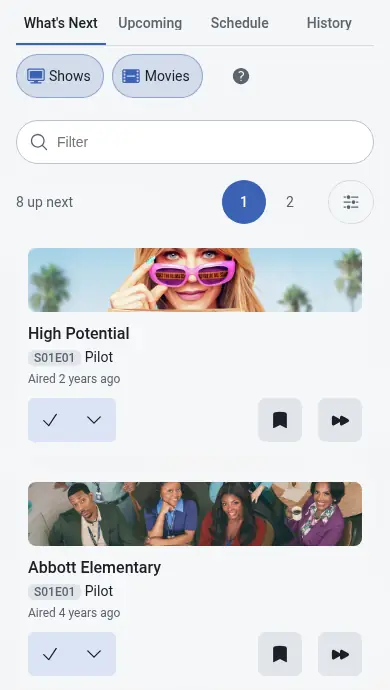

id: watching
title: Marking things watched

The  **Dashboard** opens on **What's Next**:
the next episode of every show you track, and the movies you have queued. Mark
one watched with its button:


```track
mark-watched
```

The  part marks it watched now. The arrow beside
it opens a menu for another time: **Now**, **Aired** (or **Released** for a
movie), or **Custom** for a date and time of your own. For something that has
not aired yet, only the plain button is shown.


On a phone, each item is a wide card with the show's banner:



After marking, a message with  lets you take
it back for a few seconds.

## Pending

What's Next is built from each show's *pending* episode: the one you are up
to. Marking an episode watched moves pending to the one after it.

-  **Move pending** changes when the item is
  queued, to push it down the list or bring it back up.
-  **Skip episode** moves pending to the next
  episode without marking this one watched.

On a show's page, each season can  mark its remaining episodes watched, and each episode can
be marked watched or made the next episode with its
 bookmark. Episodes you watched are kept in
their **Watch history**, where a watch can be moved to another episode or
removed.

## Upcoming and Schedule

 **Upcoming** lists what airs day by day, and
 **Schedule** shows whole weeks as a calendar. Both
only include shows and movies you track (see [Finding and adding](finding)),
and their arrows step forward and back; the button between them returns to
today, or this week.


## History

 **History** lists everything you have watched, newest
first, under the day you watched it, rewatches included. Episodes of one show
watched one after another are folded into a single entry; its
 **episodes** button lists them. The filter
matches show and movie titles.


